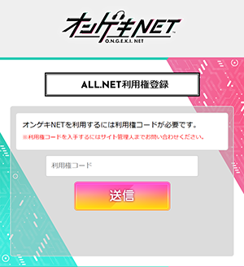
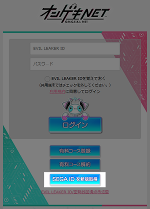
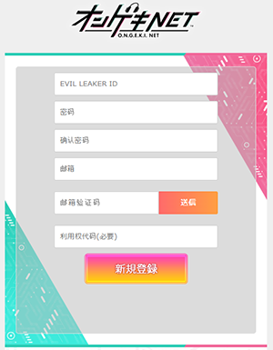
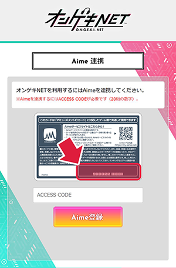
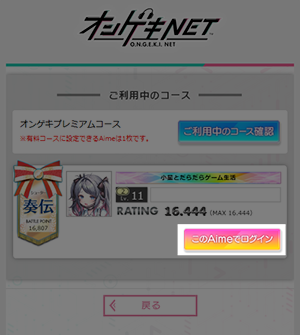
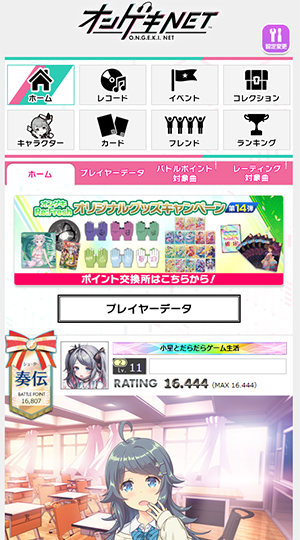

# 如何激活 ALL.NET 利用权

激活对应游戏的 ALL.NET 利用权后，继续按照首页的使用方法完成 Aime 绑定及 NET 登录。

## 目录

- **[激活特典](#activate-bonus)**
- **[音游窝等公共场所激活方法](#open-activation)**
- **[个人家用激活方法](#home-activation)**
- **[配置入网](#install-network)**

## 激活特典

> [!NOTE]
> 激活后积分与CREDIT自动发放至账户内，游戏道具则发放NET兑换码至账户。

### 店铺加入特典

- 积分 600点
- CREDIT 300点

---

### 家用加入特典

- 积分 500点
- CREDIT 200点

---

## 开始之前

- 注册EVIL LEAKER ID(**※必须※**)
- 确认你要游玩的游戏。

## 激活步骤(音游窝等公共场所)

### 游玩ONGEKI：

1. 使用Aime卡片登录游戏游玩1局并保存。

2. **<a href="https://ongeki-net.cn/ongeki-mobile/" target="_blank" rel="noopener noreferrer">登录ONGEKI-NET</a>**

---

#### 已注册EVIL LEAKER ID的情况：

- 登录后在如下界面直接输入店铺用户激活码激活ALL.NET使用权。

> [!NOTE] 如何获取店铺用户激活码？
>
> 请向你游玩的店铺经营者或张贴的公告或群组中获取激活码

> [!CAUTION]
> **店铺用户激活码不具备家用权限无法获得机台ID与DNS地址，如需家用请按下方个人家用激活另行申请专用激活码。**

<picture>
  <source media="(max-width: 600px)"
          srcset="/root/assets/ogk-activation.png">
  
</picture>

---

#### 尚未注册EVIL LEAKER ID的情况：

- 在ONGEKI-NET首页点击“注册”按钮进行注册，按页面提示输入注册信息以及店铺用户激活码完成注册激活。

> [!NOTE] 如何获取店铺用户激活码？
>
> 请向你游玩的店铺经营者或张贴的公告或群组中获取激活码

> [!CAUTION]
> **店铺用户激活码不具备家用权限无法获得机台ID与DNS地址，如需家用请按下方个人家用激活另行申请专用激活码。**

<picture>
  <source media="(max-width: 300px)"
          srcset="/root/assets/ogk-register.png">
  
</picture>

<picture>
  <source media="(max-width: 300px)"
          srcset="/root/assets/ogk-register2.png">
  
</picture>

---

3. 绑定已游玩并保存过的Aime卡号(新账号绑定的第一张Aime会默认设为主卡，后续可在主站ALL.NET服务页修改)。

<picture>
  <source media="(max-width: 300px)"
          srcset="/root/assets/ogk-aimebind.png">
  
</picture>

---

4. 选择需要登录的Aime卡

<picture>
  <source media="(max-width: 300px)"
          srcset="/root/assets/ogk-aimesel.png">
  
</picture>

---

5. 开始使用ONGEKI-NET的相关功能与服务。

<picture>
  <source media="(max-width: 300px)"
          srcset="/root/assets/ogk-top.png">
  
</picture>

## 激活步骤(个人家用)

### 游玩ONGEKI：

1. 下载ONGEKI环境检测工具进行HDD接入适配检测

- 双击 **`OngekiEnvCheckTool.exe`**

- 选择ONGEKI HDD的 **`package`** 文件夹

- 截图检测结果发给网站管理员(通过则由管理员手动配发激活码，不通过则不能获取激活码)

2. **<a href="https://ongeki-net.cn/ongeki-mobile/" target="_blank" rel="noopener noreferrer">登录ONGEKI-NET</a>**

---

#### 已注册EVIL LEAKER ID的情况：

- 登录后在如下界面直接输入个人用户激活码激活ALL.NET使用权。

<picture>
  <source media="(max-width: 600px)"
          srcset="/root/assets/ogk-activation.png">
  
</picture>

---

#### 尚未注册EVIL LEAKER ID的情况：

- 在ONGEKI-NET首页点击 **`注册`** 按钮进行注册，按页面提示输入注册信息以及个人用户激活码完成注册激活。

<picture>
  <source media="(max-width: 300px)"
          srcset="/root/assets/ogk-register.png">
  
</picture>

<picture>
  <source media="(max-width: 300px)"
          srcset="/root/assets/ogk-register2.png">
  
</picture> 

## 如何配置入网

### 下载并安装入网数据包

- **<a href="https://crew.evilleaker.com/" target="_blank" rel="noopener noreferrer">登录EVIL LEAKER主站</a>**
	
- 在左侧侧边栏进入 **`ALL.NET服务`** 页面
	
- 找到 **`ONGEKI Link`** 卡片并打开

- 点击 **`下载入网安装包`**
	
- 解压 **`ONGEKI-Network.zip`**
	
- 双击 **`install.bat”进行安装`**
	
- 根据提示选择ONGEKI HDD中的 **`package`** 文件夹
	
- 完成安装

### 配置机台

- 在主站 **`ALL.NET服务`** 页面中可以获取到ONGEKI专用KEYCHIP ID，填入segatools.ini中的 **`[keychip]id=`** 后面
	
- 在主站 **`ALL.NET服务`** 页面中可以获取到 **`魔界人.NET`**  专用连接地址，填入segatools.ini中的 **`[dns]default=`** 后面
	
- 保存 **`segatools.ini`**
	
- 双击 **`start.bat`** 或 **`launch.bat`** 来启动游戏

### 其他说明

- 入网安装包会进行全部入网配置的安装，在安装的同时会备份当前HDD原有的配置，您无需担心配置混乱或需要重新配置HDD。
	
- 需要恢复原始配置请双击运行入网安装包中的 **`restore.bat`** 按照提示选择 **`package`** 文件夹即可恢复原有配置。
	
- 入网安装包会检测不必要的BepinEx Mod文件会将其移除并进行备份。

---

**[如何导入其他服务器存档](/import)**

**[如何接入ONGEKI LINK在线联机服务](/ogklink)**

**[返回首页查看完整使用方法](/#registration)**

**[了解 NET 会员使用权](/use-right/)**
