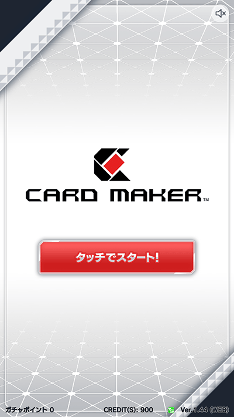
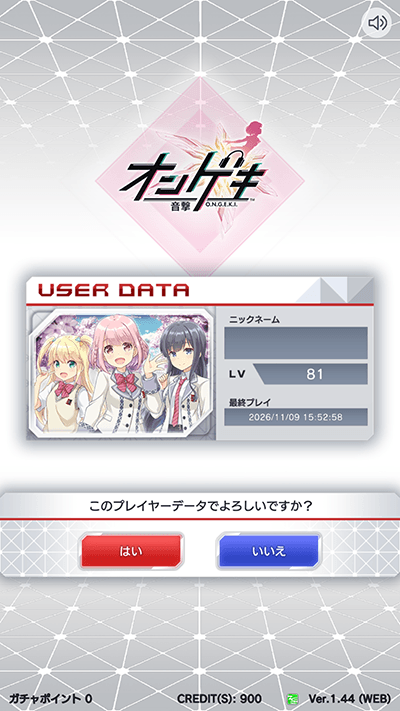
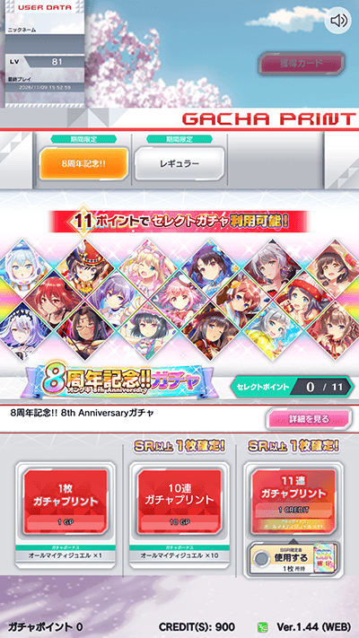
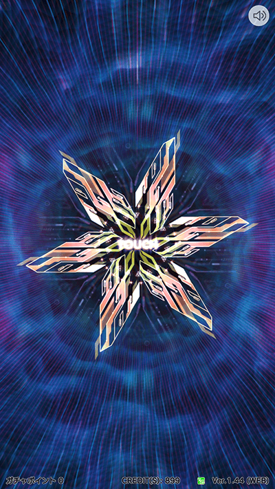
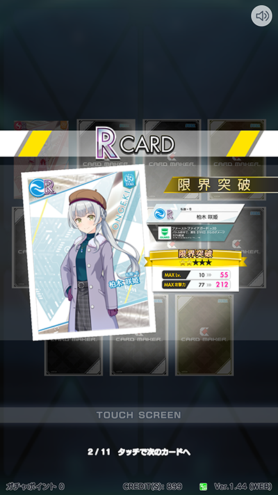
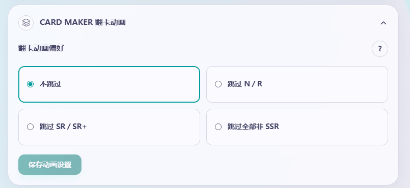

# CARD MAKER

使用CARD MAKER可以抽取ONGEKI的卡片，进行卡片突破和解花等操作。

## 目录
- **[WEB版](#cm-web)**
- **[APP版](#cm-app)**
- **[小程序版](#cm-wxapp)**

## 如何使用

### WEB版

1. 确保您已激活ONGEKI利用权，并且已成功游玩保存一局游戏和绑定Aime卡片
2. **<a href="https://crew.evilleaker.com/" target="_blank" rel="noopener noreferrer">登录EVIL LEAKER主站</a>**
3. 侧边栏进入 **`CARD MAKER`** 页面
4. 点击画面开始CARD MAKER

<picture>
  <source media="(max-width: 400px)"
          srcset="/root/assets/cm/cm-01.png">
  
</picture>

---

5. 进入后默认登录你绑定的Aime主卡，除标题界面静音外WEB版默认开启声音，你可以在标题右上角点击静音按钮，如需恢复音乐可以再次点击。

<picture>
  <source media="(max-width: 400px)"
          srcset="/root/assets/cm/cm-02.png">
  
</picture>

---

6. 登录后进入卡池选择界面

> [!NOTE]
> 目前支持 **`1抽`** 、 **`10抽`** 、 **`11抽`** 
> 1和10抽需要消耗GachaPoint(GP)，11抽需要消耗CREDIT点数，10抽与11抽均有SR作为保底卡片 
> 1抽消费1点GP，10抽消耗10点GP，11抽消耗2点CREDIT点数 
> GP需要在主站积分商店中进行兑换，兑换比例为1GP=3积分，同时也可以在ONGEKI-NET中使用游玩次数来兑换，兑换比例为1GP=3PC

<picture>
  <source media="(max-width: 400px)"
          srcset="/root/assets/cm/cm-03.png">
  
</picture>

---

7. 抽取后点击画面进入到翻卡界面

<picture>
  <source media="(max-width: 400px)"
          srcset="/root/assets/cm/cm-04.png">
  
</picture>

<picture>
  <source media="(max-width: 400px)"
          srcset="/root/assets/cm/cm-05.png">
  
</picture>

---

8. 动画设置

- 如果你不想看所有卡片的翻卡动画，可以在主站 **`ALL.NET服务`** 页面中找到 **`CARD MAKER翻卡动画`** 选项，按照设置选择需要跳过的翻卡动画类型。

>[!NOTE]
> SSR翻卡动画为始终播放无法跳过。

<picture>
  <source media="(max-width: 400px)"
          srcset="/root/assets/cm/cm-06.png">
  
</picture>

---

### APP版

> [!NOTE]
> 暂未适配 **iPhone DUO** ，使用效果可能不理想。
>
> ipa文件需要进行自签名后安装到设备中才可使用。
>
> Android 版App会稍晚发布。

**下载并安装ipa文件到你的 iPhone 或 iPad 设备中来进行抽卡**

---

#### 如何刷卡

- 在标题界面点击 **`カードをかざす`** 后根据提示进行刷卡。

> [!CAUTION]
> 自签名时个人签名方式可能没有权限启动iPhone的NFC功能，这是Apple签名的限制，请使用支持NFC权限的非个人签名或证书签名进行安装。 
> 如果不需要使用NFC刷卡，使用任何签名方式都可以安装CARD MAKER App。
---

### 微信小程序版

> [!NOTE]
> 微信小程序版登录主站账号后即与当前微信号进行绑定
>
> 从小程序退出登录不会解绑微信关联，如需解绑微信请访问主站 **ALL.NET服务** 页的 **微信小程序账号关联** 卡片进行解绑

**使用微信扫一扫登录小程序进行抽卡或管理你的Aime卡片**

<picture>
  <source media="(max-width: 400px)"
          srcset="/root/assets/wxappcode.png">
  
</picture>

---

### FAQ

- 【iOS】 支持调用 iPhone 的 NFC 功能来读取 Aime卡片 进行登录。
- 【iOS】 如果使用刷卡则需要你当前账号中已经绑定此Aime卡片才可以。
- 【共通】 如果在标题界面直接点击画面进入会直接读取你当前账号绑定的Aime主卡。
- 【共通】 **GachaPoint(GP)** 和 **CREDIT点数** 与其他平台共享当前账号余额。

---