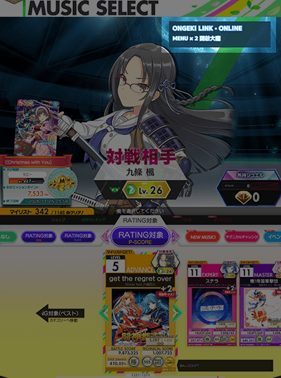
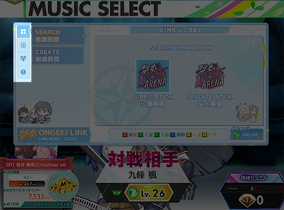
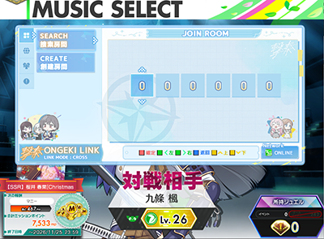
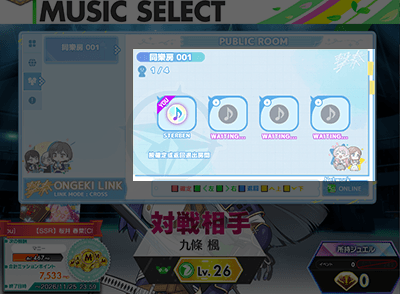

# ONGEKI LINK

ONGEKI LINK为店内对战中继服务，使用此服务通过服务器您可以随时随地和同为本服的各地玩家进行店内对战。

## 能做什么

- 使用LINK服务可以无视游戏组别限制进行跨组联机，您可以创建私密房间邀请好友进行对战，也可以创建公开房间与其他玩家进行对战。
- 目前最新版本已支持跨DATA版本进行联机，如果房间内的玩家的DATA版本都不同，进入房间后会屏蔽掉互相都没有的歌曲只保留所有人都有的，退出房间后歌单恢复正常。自制谱以及缺少谱面的抄谱都会直接无条件全部屏蔽，删除曲适用上述条件只要房间内玩家都有就可以选择。

## 如何使用

1. 确保您已激活ONGEKI利用权
2. 游戏最低版本必须为 **`Re:Fresh Ver 1.60-A`** ，不同数据版本理论上无联机限制，但您无法接收到自己没有的歌曲的房间信息。
3. **<a href="https://crew.evilleaker.com/" target="_blank" rel="noopener noreferrer">登录EVIL LEAKER主站</a>**
4. 侧边栏进入 **`ALL.NET服务`** 页面
5. 找到 **`ONGEKI Link`** 卡片，点击打开
6. 点击 **`下载LINK安装包`**
7. 点击下方 **`生成LINK配置`**，稍后需要用到 (分组联机机台配置通常无需设置，插件默认使用跨组联机模式)
8. 解压 **`ONGEKI-LINK.zip`**
9. 双击 **`install.bat`** 进行插件安装，根据提示选择 **`package`** 文件夹和上面下载的LINK配置文件完成安装
10. 进入游戏进行联机游玩

## 联机流程

- 启动游戏并登录后，进入选歌界面
- **`按键操作：L1=返回/取消、L2/L3=左右选择，R1=确定、R2/R3=上下选择`**
- 双击 **`L MENU`** 或 **`R MENU`** 按键打开LINK大厅界面，再次双击则关闭大厅界面返回选曲界面操作
- 加入房间后请双击 **`L MENU`** 或 **`R MENU`** 按键来关闭大厅界面，按 **`L1`** 键会退出房间(防误操作退出房间会有确认窗口，再次按下确认键才会退出房间)

<picture>
  <source media="(max-width: 400px)"
          srcset="/root/assets/link/link-01.png">
  
</picture>

---

- 菜单分为左列、中列、右侧页面区域，左列从上到下分别为：大厅功能(创建/搜索房间)、公开房间列表、当前加入房间信息、LINK系统信息

<picture>
  <source media="(max-width: 400px)"
          srcset="/root/assets/link/link-02.png">
  
</picture>

---

- 大厅功能中可以 **`创建`** 或 **`搜索`** 公开、私密房间，加入私密房间需要输入6位房间码

<picture>
  <source media="(max-width: 400px)"
          srcset="/root/assets/link/link-03.png">
  
</picture>

---

- 加入房间后你可以继续等待其他玩家加入房间后再开启店内联机乐曲，或者关闭LINK大厅界面继续单人游戏。

<picture>
  <source media="(max-width: 400px)"
          srcset="/root/assets/link/link-04.png">
  
</picture>

---

- 房间内会显示连胜信息，如果房主退出房间则顺延到下一个玩家为房主，整个房间不会解散，只有当最后一个玩家退出房间时房间才会解散。

- 但需注意的是，在等待过程中进行游玩，如果此时有新玩家进入了你所在的房间，LINK系统会在游玩界面进行音效提示，如果你在意怕被提示打扰，请继续在选曲界面等待其他玩家加入房间。

## 提交反馈

- LINK插件目前还处于测试阶段，如果在游戏中发生任何问题，请联系管理员处理，问题修复后可能需要更新LINK插件。

---

**[如何激活ALL.NET利用权](/activate)**

**[如何导入其他服务器存档](/import)**

**[返回首页查看完整使用方法](/#registration)**

**[了解 NET 会员使用权](/use-right/)**